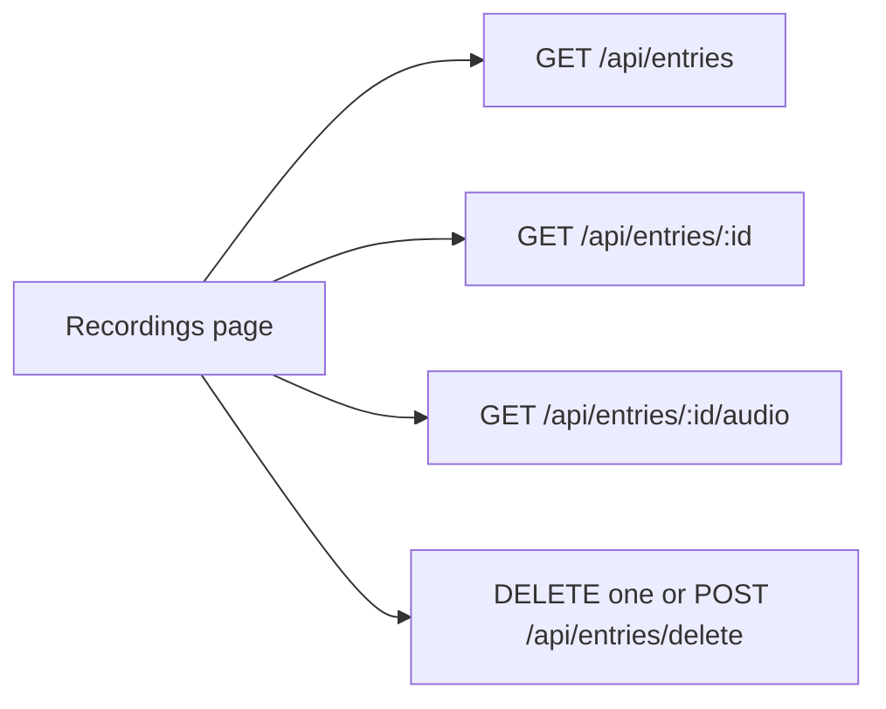

# Recordings explorer

The studio already saves each take (loudness samples in Postgres, wav under `clips/audio/<uuid>/`). [EntriesList](web/src/components/EntriesList.tsx) only prints the latest 50. There is no audio route and no delete route. [`removeClip`](server/src/services/recording.ts) already deletes a clip directory and is unused after a failed save.

Current file browsers (sample browsers and audio libraries) use a selectable list, one open player, click-to-seek on the trace, and a confirmed batch delete. This page follows that, using the loudness series this app already stores (~20 samples/s in [`useMicrophone.ts`](web/src/audio/useMicrophone.ts)) and the uPlot graph already used on the studio page. No new player library.

## Page

New route `/recordings`, same `pushState` routing as `/controls` in [App.tsx](web/src/App.tsx). Header links: Studio, Controls, Recordings.

Layout, matching the existing dark cards in [styles.css](web/src/styles.css):

- Toolbar: search (matches the shown date/time text on the loaded rows), take count, total duration of those rows, select-all for the loaded rows, Play selection, Delete selection.
- List window: a "Last" control (20, 50, 100, or a typed N) and a Paged mode. Last N requests `limit=N&offset=0` and shows only the newest N, with a line "Newest N of {total}". Paged uses the same sizes as the page size, with Previous / Next and "a–b of {total}". Changing the size goes back to the newest page. Select-all and batch delete apply to the loaded rows only.
- Scrollable list, newest first: checkbox, start time, duration. Click a row to open it. Shift-click extends the selection. Opening `?open=<id>` still loads that take when it is not on the current page.
- Detail: native `<audio controls>` for the wav, download link, uPlot of the saved loudness with the current gain applied the same way as [LiveGraph.tsx](web/src/components/LiveGraph.tsx) (`min(1, sample * gain)`), click on the graph seeks the audio, a playhead follows playback. Delete this take. If `audio_path` is missing, the graph still shows and the player says the file is gone.
- Play selection plays the checked takes in list order and advances when each one ends. Prev / Next move through that queue.
- Delete asks for confirmation, then removes the rows and wav directories. The open take clears if it was deleted. Buttons stay disabled when nothing is selected. Changing Last N, page, or mode clears the checkboxes. If a delete empties the current page, the list loads the previous page.
- Empty list and a failed save/load each get one short message.

The studio page keeps Recent recordings. Each row links to `/recordings?open=<id>`, and the explorer opens that take on load.

## API

In [entries.ts](server/src/routes/entries.ts):

- `GET /api/entries?limit=&offset=` — newest first. `limit` defaults to 50 and clamps to 1..500. `offset` defaults to 0 and clamps at 0. Response becomes `{ entries, total }` (summaries only, no samples). [EntriesList](web/src/components/EntriesList.tsx) reads `entries` and keeps the default, so Recent recordings stays the latest 50. `total` is `COUNT(*)` alongside the page query.
- `GET /api/entries/:id/audio` — stream the wav. Accept only a stored path matching `clips/audio/<uuid>/<uuid>.wav`, then resolve that uuid under the clips dir. Honor `Range` so the audio element can seek. `404` when the row or file is missing.
- `DELETE /api/entries/:id` and `POST /api/entries/delete` with `{ ids: number[] }` (max 100). One helper: delete the rows, then `removeClip` for each uuid parsed from `audio_path`.

Add the three routes to the API table in [README.md](README.md).

## Check

With `npm run dev`, open `/recordings`, play a take, seek from the loudness graph, switch Last N and step through pages, delete one take, then delete several on the current page. Confirm the wav directory is gone and Recent recordings no longer lists them.

## Phase 2

Not in this pass.

On the open clip, crop the audio by hand:

- Trim the start and the end.
- Cut one or more intervals out of the middle.
- Save overwrites that take. Save as stores a new take.
- An optional target path, when given, is where the wav is written. When omitted, the wav stays under `clips/audio/` as it does today.
- Duration and the saved loudness samples follow the regions that were kept.